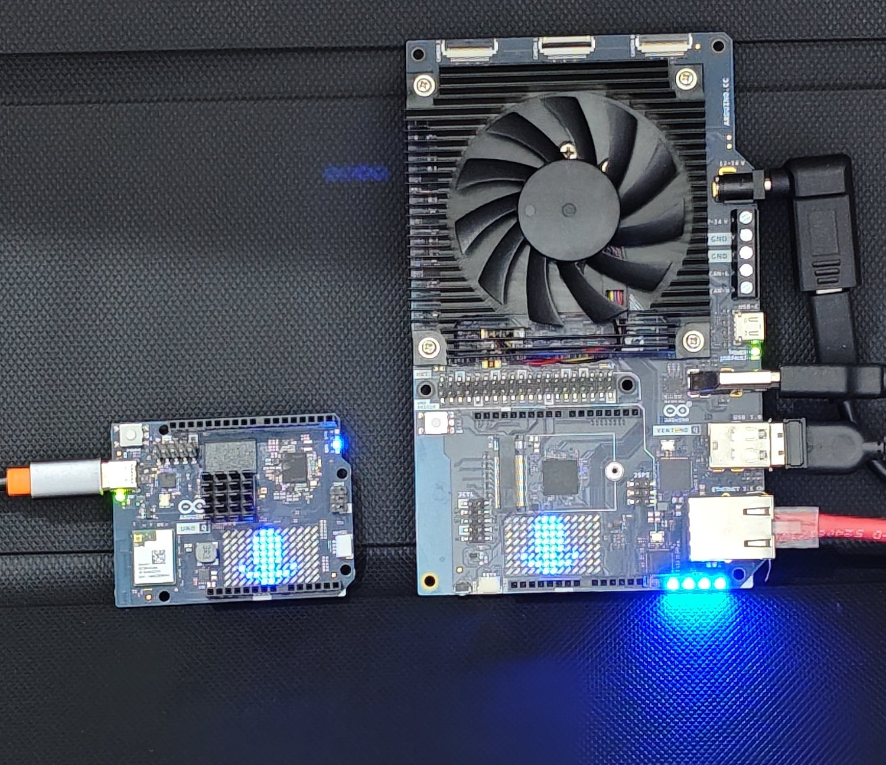
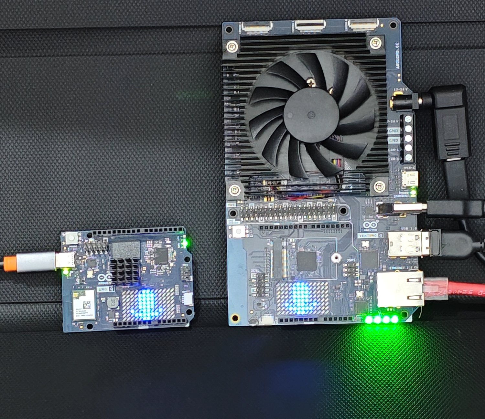
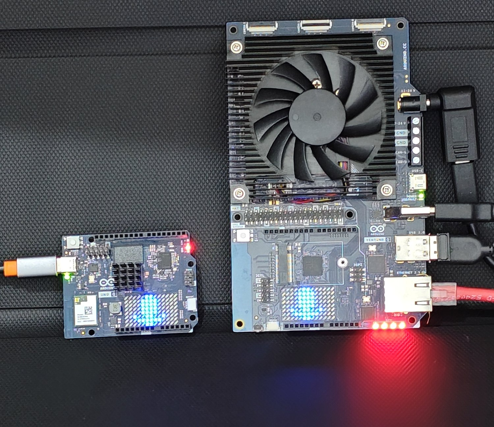
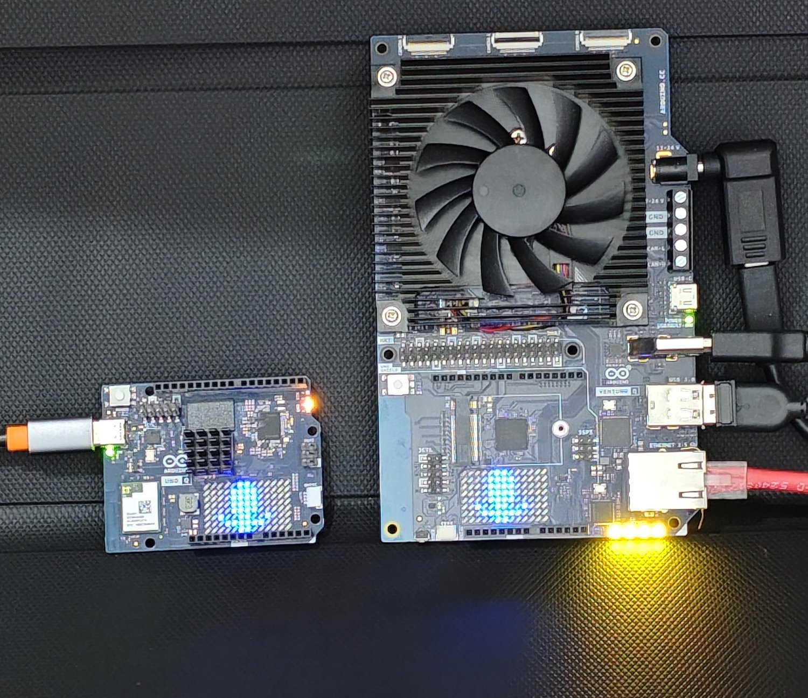
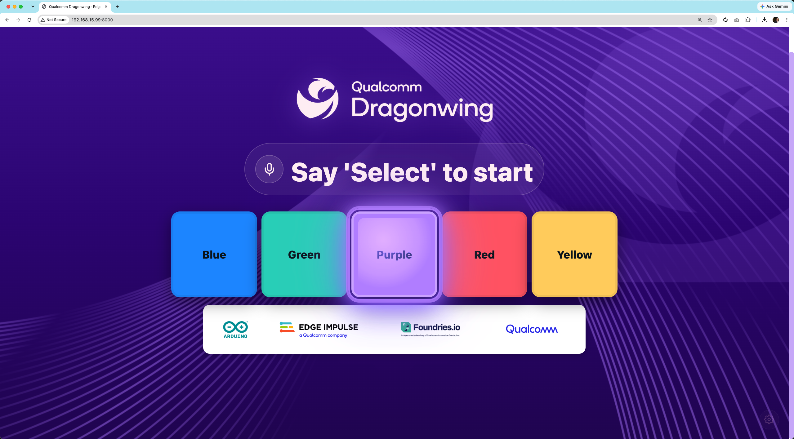

# Voice → Action: a keyword-spotting LED demo

Say **"select"**, then say a colour — **blue, green, red, purple, yellow** — and
the board lights up. The word recognition is a real [Edge
Impulse](https://edgeimpulse.com) keyword-spotting model running on-device; the
colour is drawn on an LED matrix, the board's RGB LED, and a small web page.



It runs on an **Arduino UNO Q** / **VENTUNO Q** (Qualcomm Dragonwing) — but the
whole thing is a container, so it also runs on **plain Debian or any Linux with a
microphone**. On a laptop the colours just light up in the web UI instead of on
the matrix.

<p align="center">
  
  
  
</p>

## The story

This started as a live demo: how fast can you go from *an idea for a voice
feature* to *a device that does it*? The answer turned out to be one afternoon,
because none of the hard parts are yours to build.

- **Edge Impulse** does the machine learning. You record people saying the
  colours, it trains a small keyword model, and you download it as a single
  `.eim` file. No TensorFlow, no data-science rig — see
  [`docs/edge-impulse.md`](docs/edge-impulse.md).
- **A container** does the packaging. The app, the Python runtime, the audio
  libraries, and the model all ship in one image. `docker compose up` and it
  runs the same on an Arduino board as on a Debian box.
- **The Arduino UNO Q** gives you the fun part — a real LED matrix and RGB LED
  wired to the same Linux the container runs on — without having to flash
  firmware: the matrix is driven over MCUmgr from the running app.

The best part of the demo is that **adding a new word is not a code change**.
Record it, retrain in Edge Impulse, drop in the new `.eim`, and the device knows
a new colour. That is the whole pitch of this repo.

## Run it

You need Docker and a microphone. From the repo root:

```sh
docker compose up --build
```

Then open **http://localhost:8000**, say **"select"**, and say a colour.

That is it — the Edge Impulse model is baked into the image, so there is nothing
else to download. The LED matrix and on-board LEDs light up only when you are on
the UNO Q / VENTUNO Q hardware; on a plain PC the colour shows in the web UI.



### If the microphone does not work

PortAudio uses the system default input device. If capture fails (you will see an
"Audio device error" in the UI, or `Invalid sample rate` in the logs), click the
gear (⚙) in the web UI and pick a device marked **recommended** — those are the
ALSA `default`/`plughw` devices that resample to the model's 16 kHz.

## What's in here

```
voice-workshop/
├── docker-compose.yml              # one-command demo (builds + runs the voice app)
├── apps/
│   ├── webapp-led-mcu-voice/       # the app: mic → Edge Impulse → LEDs + web UI
│   │   └── deployment.eim          # the trained keyword model (baked in)
│   └── webapp-led-mcu-voice-assets/# optional: how the model is delivered OTA on a fleet
├── dataset/                        # how to get the training audio + public EI project
└── docs/
    ├── edge-impulse.md             # reproduce the model, step by step
    └── images/                     # screenshots + board photos
```

- **[`apps/webapp-led-mcu-voice`](apps/webapp-led-mcu-voice)** — the application.
  Runs the Edge Impulse audio runner, lights the matrix/LEDs when hardware is
  present, serves the web UI on `:8000`.
- **[`apps/webapp-led-mcu-voice-assets`](apps/webapp-led-mcu-voice-assets)** —
  the fleet update path: ships a retrained model to the device as a new container
  image. Not needed for the local demo; it is here to show how the "drop in a new
  `.eim`" step works at scale.
- **[`docs/edge-impulse.md`](docs/edge-impulse.md)** — train the model yourself.
- **[`dataset/`](dataset)** — the recorded words, and the public Edge Impulse
  project you can clone.

## Add your own colour

1. Record samples of the new word and retrain in Edge Impulse
   ([`docs/edge-impulse.md`](docs/edge-impulse.md)).
2. Download the Linux `.eim`, rename it to `deployment.eim`, and replace
   `apps/webapp-led-mcu-voice/deployment.eim`.
3. Add the word to the `COLOR` / `LABELS` sets in
   `apps/webapp-led-mcu-voice/webapp-led-mcu-voice.py` so the app acts on it.
4. `docker compose up --build` again.

## Credits & licence

The application code carries `Copyright (c) 2025 Foundries.io`,
`SPDX-License-Identifier: BSD-3-Clause`. Built on
[Edge Impulse](https://edgeimpulse.com), the
[Arduino UNO Q](https://www.arduino.cc), and
[Qualcomm Dragonwing](https://www.qualcomm.com).
