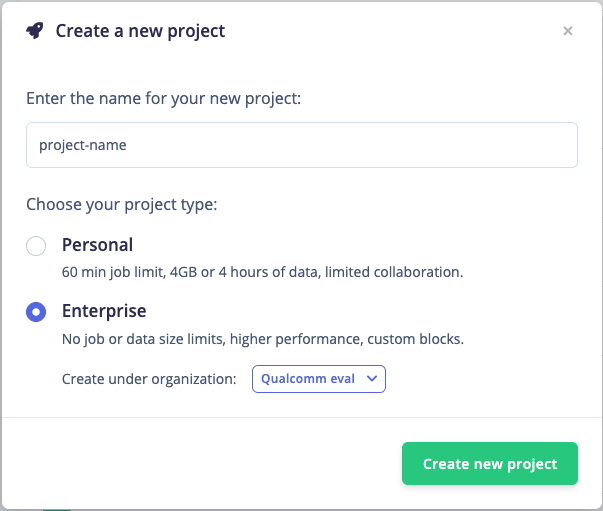
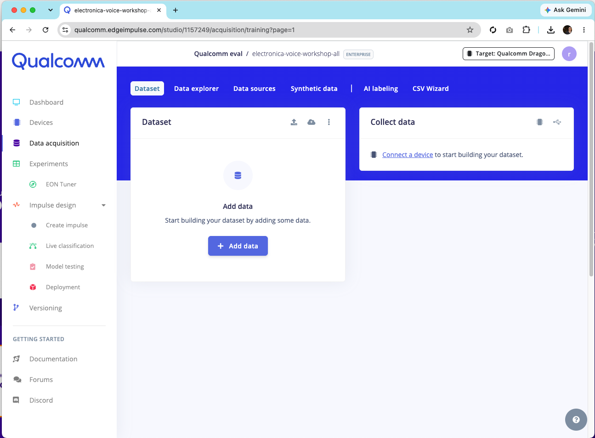
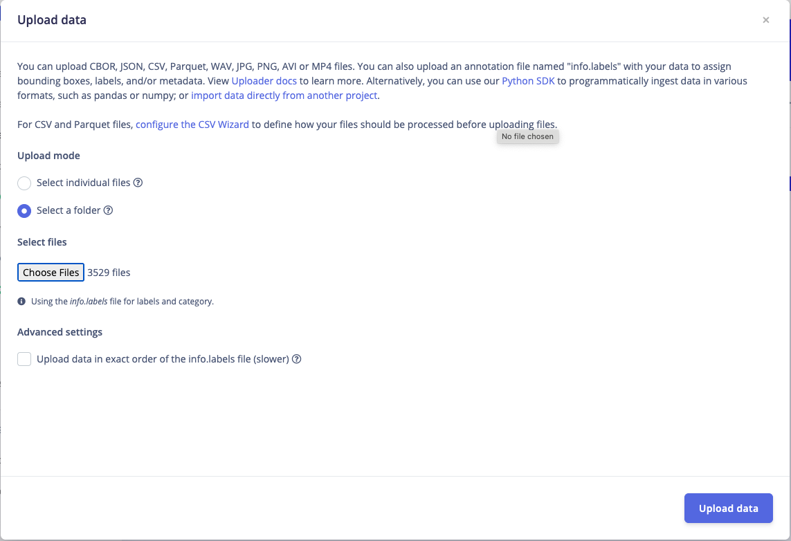
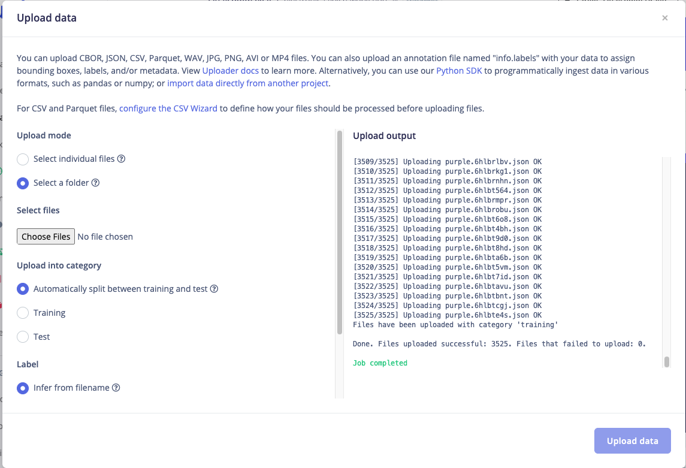
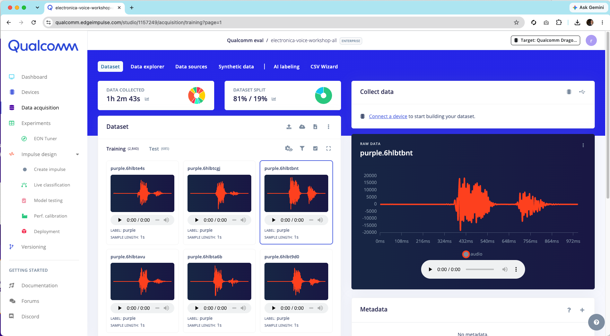
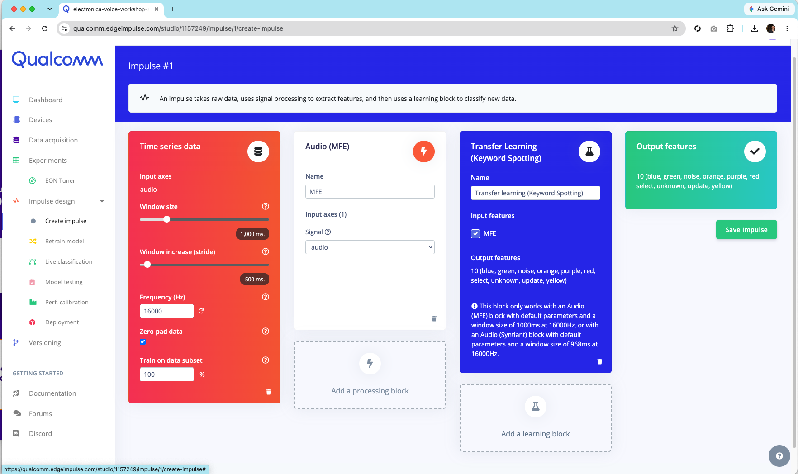
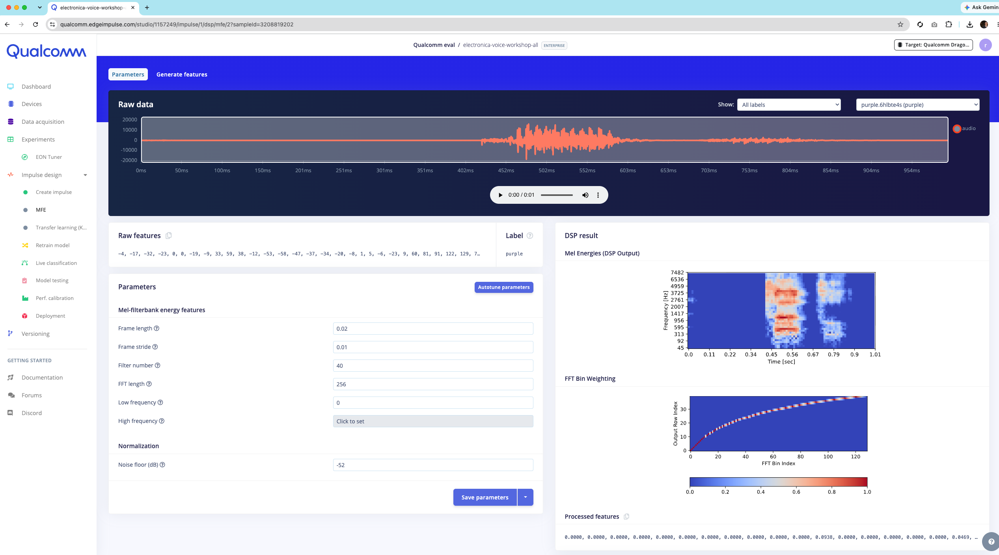
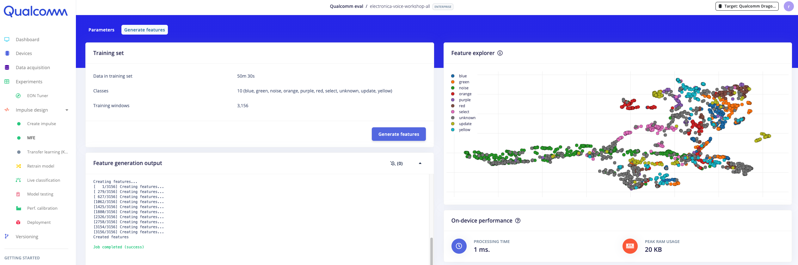
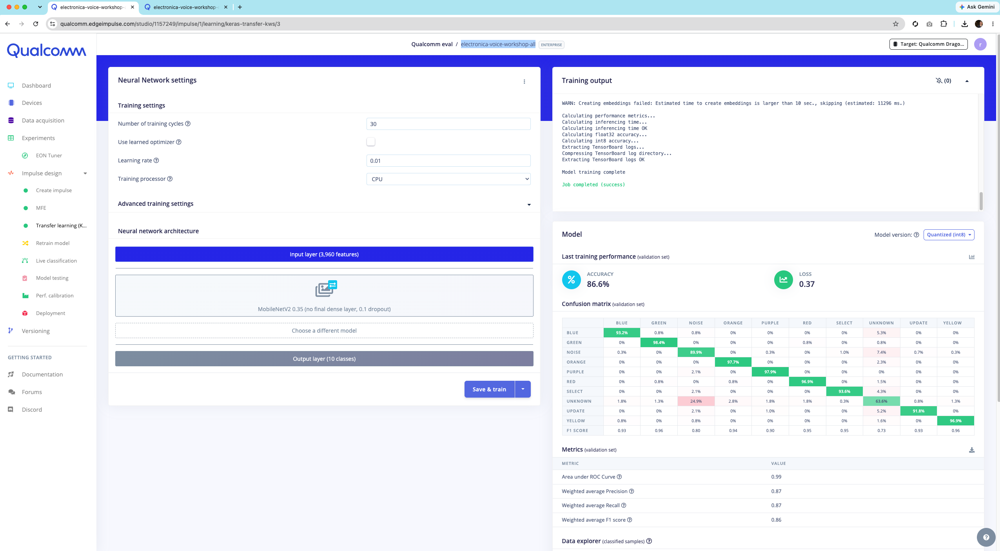
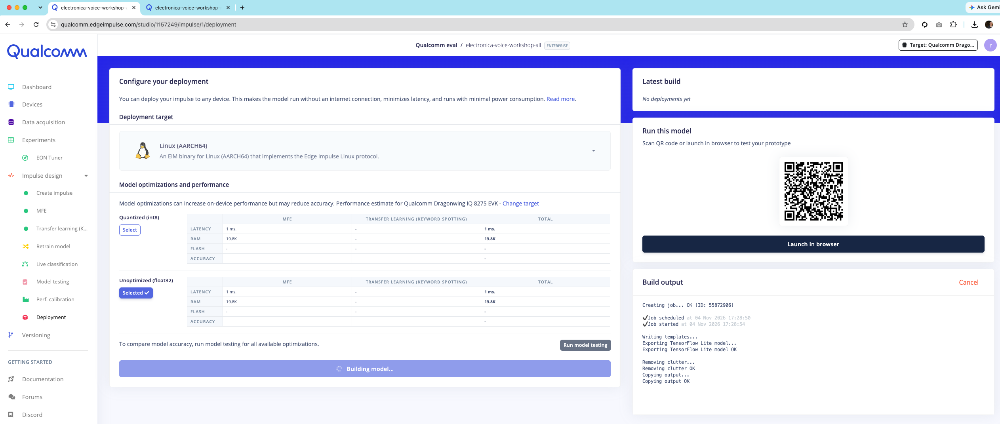

# Train the voice model in Edge Impulse

This walks through building the keyword-spotting model the app runs, from a raw
dataset of recorded words to a downloadable Linux `.eim` file. You do not have to
do this to run the demo — a trained `deployment.eim` is already baked into the
app — but reproducing it is the point of the workshop, and it is how you add your
own words later.

The finished public project and the dataset used here are linked from
[`../dataset/README.md`](../dataset/README.md).

## 1. Create a new project

Sign in to [Edge Impulse Studio](https://studio.edgeimpulse.com), create a new
project, and give it a name.

## 2. Open Data Acquisition

Go to **Data acquisition**. This is where the labelled audio lives. Click the
**upload** icon to add existing recordings.

## 3. Upload the dataset

Download and extract `edge-impulse-voice-detection-export.zip` (see
[`../dataset/README.md`](../dataset/README.md)), select the extracted folder, and
upload. Edge Impulse reads the label from each file, so the words come in already
labelled. Click **Upload data**.

Wait for the upload to finish.

## 4. Verify the samples

Back on **Data acquisition**, confirm the samples are there and split across the
ten labels: `blue`, `green`, `noise`, `orange`, `purple`, `red`, `select`,
`unknown`, `update`, `yellow`. `noise` and `unknown` are what let the model say
"that was not a keyword" instead of guessing a colour on every sound — see
[Why these labels](#why-these-labels) below.

## 5. Create the impulse

Go to **Create impulse**. An impulse is the pipeline: a time-series input, a
processing block, and a learning block.

1. The **Time series data** input block is added automatically. Leave the window
   size at **1000 ms** and the frequency at **16000 Hz** — the keyword block
   below requires these.
2. Add a processing block → **Audio (MFE)**.
3. Add a learning block → **Transfer Learning (Keyword Spotting)**. Its input is
   the MFE block and it has **10** output classes (the ten labels above).

The keyword block requires an **Audio MFE** block with its **default** parameters
and a 1000 ms window at 16000 Hz, which is exactly what step 1 and 2 set up.
Save the impulse.

### Why MFE, and why transfer learning

**Audio MFE** turns each 1 s window into a compact time–frequency picture. It
computes a spectrogram and then groups the frequencies onto the **Mel scale** —
more detail in the low frequencies, less up high, which is how human hearing
works. Per Edge Impulse's own docs, the MFE block "performs well on audio data …
when sounds to be classified can be distinguished by the human ear," which is
true of short spoken colour words. It gives the network a small, speech-shaped
input instead of a raw waveform, so the model is smaller and trains faster.
(Edge Impulse's other audio block, MFCC, is tuned specifically for human-voice
feature extraction; MFE is the one the keyword-spotting block pairs with, and it
is the default this project uses.)

**Transfer Learning (Keyword Spotting)** does not train a network from scratch.
It starts from a model Edge Impulse pretrained on a large speech/keyword corpus
and fine-tunes only the last layers on your words. The pretrained part already
knows what speech looks like, so you reach good accuracy with a **small** custom
dataset and a short training run — which is what makes a live, record-and-train
workshop feasible. A from-scratch network would need far more examples of each
word to get there.

Sources: Edge Impulse —
[Audio MFE](https://docs.edgeimpulse.com/docs/edge-impulse-studio/processing-blocks/audio-mfe),
[Keyword spotting datasets](https://docs.edgeimpulse.com/docs/pre-built-datasets/keyword-spotting).

### Why these labels

The model has ten outputs but the app only acts on six of them: the colours
`blue green purple red yellow` and the trigger word `select`. The rest —
`noise`, `unknown`, `orange`, `update` — are there so the network has somewhere
to put everything that is *not* one of the five demo colours. Without `noise`
and `unknown`, every cough or stray word would be forced into the nearest colour.

## 6. Generate features

Open the **MFE** block, click **Save parameters**.

On the next screen click **Generate features**. This runs the MFE transform over
the whole dataset so you can see the classes separate in the feature explorer.

## 7. Train

Open the **Transfer learning** block and click **Save & train** (**Start
training**). Wait for the job to finish; the training output shows the accuracy
and confusion matrix.

## 8. Deploy as a Linux model

Go to **Deployment**. Search for and select **Linux (AARCH64)** — the UNO Q /
VENTUNO Q and most Arm64 Linux boards. Leave the optimization at **Unoptimized
(float32)**, then **Build**.

The browser downloads a file named
`electronica-voice-workshop-all-linux-aarch64-v1-impulse-#1.eim`. Rename it to
`deployment.eim` and drop it in:

- `apps/webapp-led-mcu-voice/deployment.eim` — the app loads this directly.
- `apps/webapp-led-mcu-voice-assets/deployment.eim` — only if you use the OTA
  delivery path (see that app's README); not needed for the local Docker demo.

> **AARCH64 vs your laptop:** the `.eim` here is an Arm64 build. If you want to
> run the Docker demo on an x86 PC, build the model for **Linux (x86_64)**
> instead and swap in that `.eim`. The committed one targets the Arm64 boards.

That is the whole loop: record words → MFE → transfer-learn → download `.eim`.
Add a new colour by recording it, retraining, and rebuilding — nothing in the app
changes except the model file.
